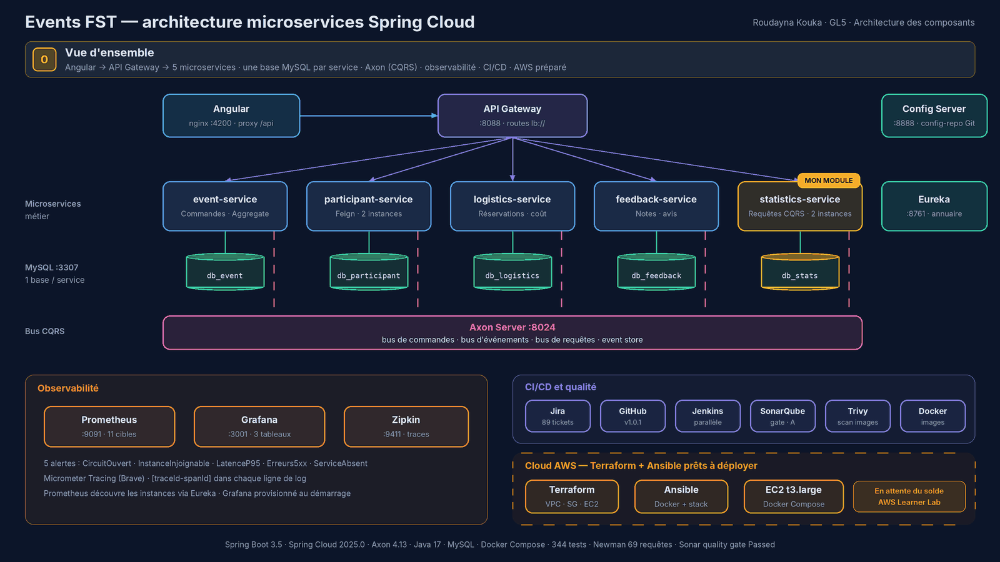
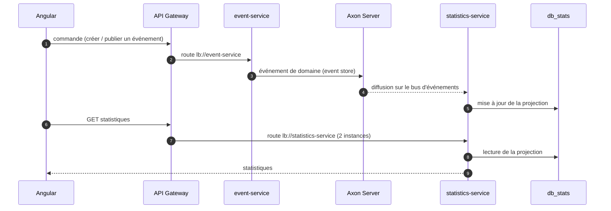

<div align="center">

# 🎓 Events FST — Microservices Spring Cloud

**Gestion des événements de la Faculté des Sciences de Tunis**
événements · participants · logistique · feedbacks · **statistiques**

Architecture microservices Spring Cloud · CQRS avec Axon · observabilité · CI/CD · AWS

<br>


<br>

Projet individuel — **DS Architecture des composants**, GL5 — **Roudayna Kouka**
Module mis en avant : ⭐ **statistics-service** (côté requêtes CQRS)

<br>



</div>

---

## 📑 Sommaire

- [✨ Points forts](#-points-forts)
- [🏗️ Architecture](#️-architecture)
- [⭐ Mon module : statistics-service](#-mon-module--statistics-service)
- [🧰 Stack technique](#-stack-technique)
- [📊 Résultats finaux](#-résultats-finaux)
- [🚀 Démarrage rapide](#-démarrage-rapide)
- [🛡️ Résilience et répartition de charge](#️-résilience-et-répartition-de-charge)
- [🔭 Observabilité](#-observabilité)
- [⚙️ CI/CD et qualité](#️-cicd-et-qualité)
- [☁️ Déploiement AWS](#️-déploiement-aws)
- [🌐 URL des composants](#-url-des-composants)
- [🗺️ État d'avancement](#️-état-davancement)
- [📚 Livrables](#-livrables)
- [📁 Arborescence](#-arborescence)

---

## ✨ Points forts

| | |
|---|---|
| 🧩 **5 microservices métier** | event, participant, logistics, feedback, statistics — chacun avec **sa propre base MySQL** |
| 🔀 **CQRS + Event Sourcing** | agrégat event-sourcé côté commandes, projections et requêtes côté statistics, **replay** de la projection |
| 🛡️ **Résilience** | Resilience4j (Retry, RateLimiter, CircuitBreaker, TimeLimiter), fallbacks, **5 scénarios de panne** reproductibles |
| ⚖️ **Répartition de charge** | 2 instances de participant-service et de statistics-service, LoadBalancer via Eureka |
| 🔭 **Observabilité complète** | Prometheus (11 cibles, 5 alertes), Grafana (3 tableaux de bord), Zipkin (traces distribuées) |
| ✅ **Qualité mesurée** | 344 tests, 69 requêtes Newman, quality gate SonarQube **Passed**, seuil JaCoCo bloquant |
| 🔁 **Pipeline Jenkins** | détection des changements, étapes parallèles, Sonar, Trivy |
| ☁️ **Cloud prêt** | Terraform + Ansible vers une EC2, vérifiés sans rien créer (`make aws-check`) |

---

## 🏗️ Architecture


| Couche | Composants |
|---|---|
| **Entrée** | Angular (nginx `:4200`, proxy `/api`) → **API Gateway** (`:8088`, routes `lb://`, CORS) |
| **Socle** | **Config Server** (`:8888`, config-repo Git) · **Eureka** (`:8761`, annuaire) |
| **Métier** | `event-service` (commandes, agrégat) · `participant-service` (Feign, 2 instances) · `logistics-service` (réservations, coût) · `feedback-service` (notes, avis) · `statistics-service` (requêtes CQRS, 2 instances) |
| **Données** | MySQL `:3307` — **une base et un utilisateur par service** (`db_event`, `db_participant`, `db_logistics`, `db_feedback`, `db_stats`) |
| **Bus CQRS** | **Axon Server** (`:8024`) — bus de commandes, bus d'événements, bus de requêtes, event store |
| **Observabilité** | Prometheus (`:9091`) · Grafana (`:3001`) · Zipkin (`:9411`) |
| **CI/CD** | Jira · GitHub · Jenkins · SonarQube · Trivy · Docker |
| **Cloud** | Terraform (VPC, SG, EC2) · Ansible (Docker + stack) · EC2 t3.large (Docker Compose) |

### Flux CQRS



---

## ⭐ Mon module : statistics-service

> Côté **requêtes** du CQRS : il ne reçoit aucune commande, il construit ses vues à partir des événements Axon.

- 📥 **Projections** alimentées par les événements publiés dans Axon Server, stockées dans `db_stats`.
- 🔎 **Requêtes CQRS** exposées via la Gateway et consommées par l'écran Statistiques d'Angular (graphiques SVG).
- 🔁 **Replay** de la projection depuis l'event store (`make replay`), avec 2 instances en parallèle.
- ⚖️ **2 instances** derrière le LoadBalancer (`make repartition`).
- 📈 **97,7 %** des lignes couvertes ; vulnérabilités Trivy HIGH + CRITICAL corrigeables passées de **18 à 7**.
- 🧭 Version **AVANT CQRS** (Feign, phase 2) conservée pour la comparaison AVANT / APRÈS de la présentation.

---

## 🧰 Stack technique

| Domaine | Technologies |
|---|---|
| Backend | Java 17 · Spring Boot 3.5.16 · Spring Cloud 2025.0.3 · OpenFeign · Resilience4j · Spring Cloud LoadBalancer |
| CQRS / Event Sourcing | Axon Framework 4.13.3 · Axon Server |
| Données | MySQL (une base par service) |
| Frontend | Angular 20 · nginx · Vitest · Playwright |
| Observabilité | Micrometer · Prometheus · Grafana · Zipkin (Micrometer Tracing / Brave) |
| Tests et API | JUnit · JaCoCo · Postman / Newman · Swagger agrégé |
| CI/CD et qualité | Jenkins · SonarQube · Trivy · Docker · Docker Compose · GitFlow · Jira |
| Cloud | AWS EC2 · Terraform · Ansible |

---

## 📊 Résultats finaux

> Build Jenkins n° **9**, commit `d910ee1`, **2026-11-17**

<table>
<tr>
<td align="center"><b>344</b><br>tests verts</td>
<td align="center"><b>77,7 %</b><br>couverture</td>
<td align="center"><b>69</b><br>requêtes Newman</td>
<td align="center"><b>137</b><br>assertions, 0 échec</td>
<td align="center"><b>5 / 5</b><br>pannes maîtrisées</td>
<td align="center"><b>A</b><br>fiabilité · sécurité · maintenabilité</td>
</tr>
</table>

| Indicateur | Résultat |
|---|---|
| Tests | **344** verts (`mvn clean verify`, comptés aussi par Sonar) ; seuil JaCoCo respecté dans les 5 services (statistics-service : 97,7 % des lignes) |
| Postman / Newman | **69** requêtes, **137** assertions, 0 échec ; `make newman-pannes` : 5 pannes sur 5 |
| Frontend | 10 tests Vitest ; `make e2e` : 13 contrôles dans Chromium |
| SonarQube | quality gate **Passed** ; 0 bug, fiabilité **A** ; 0 vulnérabilité, sécurité **A** ; 26 code smells, maintenabilité **A** ; couverture **77,7 %** ; duplication **0,7 %** ; 4 356 lignes de code |
| Security Hotspots | 1 seul, revu à **100 %** (**A**) : `java:S3752` (CSRF) sur le fallback `IndisponibleController`, **Safe**, car il accepte toutes les méthodes pour les forward des routes, répond 503 en lecture seule, sans session ni cookie (THEORIE Q31) |
| Trivy (HIGH + CRITICAL corrigeables) | services Java : 6 à 8 (3 CRITICAL, 4 pour eureka-server), dont statistics-service 7 (contre 18 au build 1) ; frontend 0 (contre 57) |
| Jenkins | builds 1 à 9 en SUCCESS ; Push et AWS désactivés par défaut |

---

## 🚀 Démarrage rapide

### Prérequis

- WSL Ubuntu avec Docker Desktop (intégration WSL activée), JDK 17, Maven 3.9.
- Ports libres : `4200`, `8088`, `8888`, `8761`, `3307` (voir [docs/PLAN.md](docs/PLAN.md), section 4).
  Les ports de `~/devops` (`8080`, `8081`, `9000`, `9090`, `3000`) ne sont pas utilisés.

### En 4 commandes

```bash
cd ~/events-microservices
make build    # mvn verify : compilation et tests
make up       # crée .env si besoin, construit les images, démarre et attend « healthy »
make health   # tests de fumée
make seed     # jeu de données de démonstration (par les API, via la Gateway)
```

Puis ouvrir 👉 **http://localhost:4200**

> ⚠️ `make up` lit `config-repo/` sur la **branche Git courante** : une modification de configuration doit être commitée pour être servie.

<details>
<summary><b>Toutes les commandes <code>make</code></b></summary>

```bash
make panne N=1   # scénario de panne 1 à 5, rétabli automatiquement (scripts/pannes)
make repartition # répartition de charge entre les 2 instances (Gateway, Feign, bascule)
make replay      # replay de la projection CQRS (2 instances de statistics-service)
make newman      # collection Postman (69 requêtes)
make newman-pannes # scénarios de panne vérifiés par Newman
make front-test  # frontend : tests Vitest et build (node:22)
make e2e         # frontend : parcours complet dans Chromium (Playwright)
make aws-check   # AWS : Terraform, Ansible, scripts vérifiés sans rien créer
make down        # arrêt (données conservées)
make help        # liste complète
```

Le détail de chaque commande et le résultat attendu sont dans [docs/COMMANDES.md](docs/COMMANDES.md).

</details>

---

## 🛡️ Résilience et répartition de charge

- **Resilience4j** sur les appels Feign : Retry, RateLimiter, CircuitBreaker, TimeLimiter, avec fallbacks.
- **Circuits séparés** pour les appels utilisateurs et les appels `-batch` (module `common`).
- **Fallback Gateway** (`IndisponibleController`) : réponse 503 propre quand un service est absent.
- **5 scénarios de panne** reproductibles avec `make panne N=1..5`, rétablis automatiquement, et vérifiés par `make newman-pannes`.
- **LoadBalancer** : 2 instances de `participant-service` et de `statistics-service` ; l'en-tête `X-Instance-Id` montre quelle instance a répondu (`make repartition`).

---

## 🔭 Observabilité

| Outil | Rôle |
|---|---|
| **Prometheus** `:9091` | 11 cibles, découvertes **via Eureka** ; 5 alertes : `CircuitOuvert`, `InstanceInjoignable`, `LatenceP95`, `Erreurs5xx`, `ServiceAbsent` |
| **Grafana** `:3001` | 3 tableaux de bord, provisionnés au démarrage (dossier « Events FST ») |
| **Zipkin** `:9411` | traces distribuées (Micrometer Tracing / Brave), `[traceId-spanId]` dans chaque ligne de log |

---

## ⚙️ CI/CD et qualité

```
Jira (89 tickets) → GitHub (v1.0.0) → Jenkins → SonarQube (quality gate) → Trivy → images Docker
```

- **Jenkins** (job local `events-microservices`) : détection des services modifiés, étapes **parallèles**, analyse Sonar et attente du quality gate, scan Trivy des images.
- **JaCoCo bloquant** dans `mvn verify` : lignes ≥ 70 %, branches ≥ 60 %.
- **Push** (Docker Hub) et **AWS** désactivés par défaut — activation décrite dans [APRES-PUSH](docs/APRES-PUSH.md).
- **Backlog Jira** importable : `EVT-1` à `EVT-89` (dossier `jira/`).

---

## ☁️ Déploiement AWS

| Outil | Rôle |
|---|---|
| **Terraform** | VPC, Security Group, EC2 t3.large (tests simulés, rien de créé) |
| **Ansible** | installation de Docker et déploiement de la stack |
| **EC2** | stack lancée avec Docker Compose |

```bash
make aws-check   # vérifie Terraform, Ansible et les scripts sans rien créer
make aws-up      # déploiement
make aws-down    # destruction
```

> 🕓 Infrastructure **prête à déployer**, en attente du solde AWS Learner Lab. Procédure complète : [docs/AWS-RUNBOOK.md](docs/AWS-RUNBOOK.md).

---

## 🌐 URL des composants

| Composant | URL |
|---|---|
| 🖥️ **Frontend Angular** | http://localhost:4200 |
| 🚪 API Gateway (point d'entrée des API) | http://localhost:8088/api/... |
| 🧭 Routes de la Gateway | http://localhost:8088/actuator/gateway/routes |
| 📘 Swagger agrégé | http://localhost:8088/swagger-ui.html |
| 📇 Eureka | http://localhost:8761 |
| ⚙️ Config Server | http://localhost:8888/{service}/default |
| 🔀 Axon Server (event store, commandes, requêtes) | http://localhost:8024 |
| 🗄️ MySQL | `localhost:3307` (une base et un utilisateur par service) |
| 📈 Prometheus (cibles, alertes) | http://localhost:9091 |
| 📊 Grafana (dossier « Events FST ») | http://localhost:3001 |
| 🧵 Zipkin (traces) | http://localhost:9411 |
| 🔁 Jenkins (`~/devops`), job du projet | http://localhost:8080/job/events-microservices/ |
| 🔍 SonarQube (`~/devops`) | http://localhost:9000/dashboard?id=events-microservices |

---

## 🗺️ État d'avancement

| Phase | Contenu | État |
|---|---|---|
| 0 | Monorepo, POM parent, GitFlow, backlog JIRA, livrables | ✅ Terminée |
| 1 | Socle : Config Server, Eureka, Gateway, MySQL, Docker Compose | ✅ Terminée |
| 2 | Services métier + Feign (statistics en version AVANT CQRS), `make seed` | ✅ Terminée |
| 3 | CQRS Axon : agrégat event-sourcé, publications, projections et requêtes de statistics-service, replay | ✅ Terminée |
| 4 | Resilience4j (Retry, RateLimiter, CircuitBreaker, TimeLimiter), fallbacks, 5 pannes (`make panne N=1..5`) | ✅ Terminée |
| 5 | LoadBalancer : 2 instances de participant et de statistics, `make repartition`, `make replay` | ✅ Terminée |
| 6 | Observabilité : Prometheus (découverte Eureka), Grafana (3 tableaux de bord), Zipkin, alertes | ✅ Terminée |
| 7 | Swagger agrégé, Postman (local et AWS), `make newman`, `make newman-pannes` | ✅ Terminée |
| 8 | Keycloak | ➖ Retirée du périmètre (THEORIE Q19) |
| 9 | Angular 20 allégé : statistiques (graphiques SVG), événements, participants, logistique, avis, via la Gateway | ✅ Terminée |
| 10 | Seuil JaCoCo bloquant dans `mvn verify` (lignes ≥ 70 %, branches ≥ 60 %) | ✅ Terminée |
| 11 | Pipeline Jenkins (job local `events-microservices`) : détection des changements, Sonar et quality gate, Trivy, étapes parallèles ; push et AWS désactivés | ✅ Terminée |
| 12 | AWS préparé sans rien créer : Terraform (EC2, tests simulés), Ansible, `make aws-up` / `aws-down`, AWS-RUNBOOK | ✅ Terminée (déploiement à lancer : AWS-RUNBOOK.md) |
| 13 | Livrables finaux, tag `v1.0.0` | ✅ Terminée |

---

## 📚 Livrables

| Document | Contenu |
|---|---|
| 📐 [PLAN](docs/PLAN.md) | Plan détaillé du projet, ports et choix techniques |
| 🧾 [COMMANDES](docs/COMMANDES.md) | Toutes les commandes, par technologie, avec le résultat attendu |
| 📸 [CAPTURES](docs/CAPTURES.md) | Liste des captures d'écran (C1 à C97) |
| 🎬 [SCENARIO-DEMO](docs/SCENARIO-DEMO.md) | Démonstration de 10 minutes, préparation et plans de secours |
| 🎓 [THEORIE](docs/THEORIE.md) | Questions du jury et réponses (Q1 à Q31) |
| 🖼️ [PRESENTATION-PLAN](docs/PRESENTATION-PLAN.md) | Plan des slides, avec extraits AVANT / APRÈS |
| ✅ [ETAT-FINAL](docs/ETAT-FINAL.md) | Ce qui est fait et testé, ce qui reste |
| 🚀 [APRES-PUSH](docs/APRES-PUSH.md) | Publication GitHub, webhook Jenkins, Docker Hub |
| ☁️ [AWS-RUNBOOK](docs/AWS-RUNBOOK.md) | Déploiement sur l'EC2 et destruction |
| 📓 [JOURNAL](JOURNAL.md) | Heures réelles, problèmes et corrections, phase par phase |
| 🏗️ [Schéma d'architecture](docs/architecture-events-microservices.gif) | Vue d'ensemble de l'architecture (GIF) |

---

## 📁 Arborescence

<details>
<summary><b>Afficher l'arborescence du dépôt</b></summary>

```
events-microservices/
├── pom.xml                 POM parent (Boot 3.5.16, Spring Cloud 2025.0.3, Axon 4.13.3)
├── config-server/          Configuration centralisée (Git + surcharges à chaud)
├── eureka-server/          Annuaire de services
├── api-gateway/            Point d'entrée : routes lb://, CORS
├── common/                 Erreurs JSON, en-tête X-Instance-Id, résilience Feign (circuits utilisateurs et -batch)
├── events-api/             Contrats des événements Axon (records, sans dépendance)
├── participant-service/    Participants (8102, db_participant)
├── logistics-service/      Logistique et coût réservé (8103, db_logistics)
├── event-service/          Événements, Feign, calculCout (8101, db_event)
├── feedback-service/       Avis sur les événements terminés, Feign (8104, db_feedback)
├── statistics-service/     ⭐ Mon module : côté requêtes CQRS (8105, db_stats), replay
├── config-repo/            Configuration de référence (un YAML par service)
├── config-overrides/       Surcharges à chaud des scénarios de panne (non versionnées)
├── frontend/               Angular 20 (5 écrans, statistiques en SVG), nginx, tests Vitest, e2e Playwright
├── docker/                 MySQL (init), Prometheus, Grafana (tableaux générés)
├── docker-compose.yml      Stack locale (profils core, lite, observability, frontend)
├── Makefile                make up / health / panne / newman / e2e / aws-check… (make help)
├── scripts/                init-env, health, seed-demo, pannes/ (5 scénarios), répartition, replay
├── postman/                Collection (69 requêtes), pannes, environnements local et AWS
├── Jenkinsfile             Pipeline multi-services (phase 11)
├── ci/                     Détection des changements, quality gate, job Jenkins, git daemon
├── infra/aws/              Terraform (EC2), Ansible, make aws-up / aws-down (phase 12)
├── jira/                   Backlog importable (EVT-1 à EVT-89)
└── docs/                   Plan, commandes, captures, théorie, scénario, présentation, après-push, AWS, état final,
                            architecture-events-microservices.gif
```

</details>

---

<div align="center">

**Roudayna Kouka** · GL5 · Faculté des Sciences de Tunis
DS Architecture des composants — 2026

</div>
