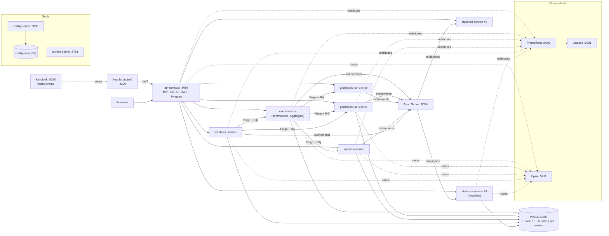

# Plan — Events en microservices Spring Cloud

DS Architecture des composants · FST · GL5 — Roudayna Kouka
Module mis en avant : **statistics-service** (côté requêtes CQRS, projections et tableau de bord).

> Statut : **plan validé le 15/11**. Le dépôt d'équipe `IGL5-G2-EventsProjetcs` est seulement lu, jamais modifié.

### Décisions validées

| Sujet | Décision |
|---|---|
| Versions | **Spring Boot 3.5.16, Spring Cloud 2025.0.3, Axon 4.13.3, springdoc 2.8.17**. Boot 3.3 est hors support de sécurité ; Boot 4 n'est pas supporté par Axon 4 (THEORIE Q2) |
| Deadline | Non fixée : l'avancement est rappelé au début de chaque phase |
| Ordre de repli | 1. exigences de l'énoncé (socle, 5 services, Feign, Resilience4j + 5 pannes, LoadBalancer, CQRS, Prometheus/Grafana/Zipkin) ; 2. Git/JIRA et livrables ; 3. Jenkins et SonarQube ; 4. frontend ; 5. Keycloak ; 6. préparation AWS |
| Docker | Intégration WSL de Docker Desktop activée par l'utilisatrice (prérequis de la phase 1) ; Node LTS installé dans WSL avec nvm |
| Frontend | Base Angular 20 de `feature/feedback`, + écrans participants et logistique, + dashboard statistiques avec graphiques |
| AWS | Cible A (EC2 + Docker Compose, rsync, build sur place) ; type d'instance en variable Terraform : `t3.large` par défaut, `t3.medium` + profil `lite` en repli |
| Git | Identité `Roudayna Kouka <roudayna.kouka@etudiant-fst.utm.tn>` ; aucune mention de Claude ; ni push ni remote |
| `~/devops` | Inspection en lecture seule à la phase 11, aucune modification |
| Identifiants | UUID pour les événements (agrégat Axon), entiers auto-incrémentés pour participant, logistique et feedback (THEORIE Q1) |

---

## 0. Environnement constaté (lecture seule, 15/11)

| Élément | Constat | Conséquence |
|---|---|---|
| PC | **31,7 Go de RAM**, 20 processeurs logiques | La stack complète tient en local |
| WSL `Ubuntu` | 20 Go max (`.wslconfig`), swap 8 Go, JDK **17.0.20**, Maven **3.9.16**, Git 2.53 | Java 17 impose Spring Boot 3 (déjà le cas) |
| Node | **absent de WSL**, Node 22.16 côté Windows | Build Angular dans un conteneur `node:22` (aucune installation nécessaire) |
| Docker | Docker Desktop (Compose v2.40) **arrêté** au moment de l'analyse ; **commande `docker` absente de la distribution `Ubuntu`** (intégration WSL désactivée) | Question Q2 : activer l'intégration WSL pour `Ubuntu` |
| `~/devops` | Jenkins **8080** et 50000, SonarQube **9000**, Nexus **8081** ; `docker-compose.monitoring.yml` : app 8083, node-exporter 9100, Prometheus **9090**, Grafana **3000** | Ces ports sont réservés, je ne les utilise pas |
| Windows | **MySQL local sur 3306** (`mysqld`), 9080 (Nahimic), 9222 (Edge), 4096 (kilo) | Le MySQL du projet sera exposé sur **3307** |
| Dossier de travail | `~/events-microservices` dans WSL, **pas sous `/mnt/c`** | Évite le problème `ansible.cfg` ignoré dans un dossier en écriture pour tous, déjà vu sur AWS Academy |

---

## 1. Diagnostic de l'existant, branche par branche

Toutes les branches sont des **copies du même monolithe** (Spring Boot 2.7.18, Java 8, MySQL `eventsProject`, port 8089, context-path `/events`). Chaque coéquipière a enrichi sa partie et ses tests dans sa copie. Aucune branche ne contient à elle seule toutes les features.

### 1.1 Modèle de données (union des branches)

| Entité | Champs | Relations JPA | Branche de référence |
|---|---|---|---|
| `Event` | `idEvent` (int), `description`, `dateDebut`, `dateFin`, `cout` (float) | `@ManyToMany(mappedBy="events") Set<Participant>`, `@OneToMany(EAGER) Set<Logistics>` | `feature/event` |
| `Participant` | `idPart` (int), `nom`, `prenom`, `tache` (enum `Tache` : INVITE, ORGANISATEUR, SERVEUR, ANIMATEUR) | `@ManyToMany Set<Event>` (propriétaire de la table de jointure) | `feature/participant` |
| `Logistics` | `idLog` (int, IDENTITY), `description`, `reserve`, `prixUnit`, `quantite` | aucune (rattachée par la jointure `Event.logistics`) | `feature/logistics` |
| `Feedback` | `id`, `note` (1 à 5), `commentaire`, `date` (Instant) ; contrainte unique `(event_id, participant_id)` | `@ManyToOne Event`, `@ManyToOne Participant` | `feature/feedback` (**absent de main**) |

### 1.2 Endpoints existants (context-path `/events`)

| Feature | Endpoints | Branche |
|---|---|---|
| Événements | `POST event/addPart`, `POST event/addEvent`, `POST event/addEvent/{idPart}`, `PUT event/addAffectLog/{description}`, `GET event/getLogs/{d1}/{d2}` ; **aucun `GET` d'un événement ni de la liste** | `feature/event` |
| Participants | `POST participant/add`, `GET participant/all`, `GET participant/{id}`, `PUT participant/update/{id}`, `PUT participant/{id}/tache/{tache}`, `DELETE participant/delete/{id}` ; DTO et `Mapper` en plus | `feature/participant` |
| Logistique | `POST/PUT/GET /logistics`, `GET/DELETE /logistics/{id}`, `GET /logistics/reserved`, `GET /logistics/{id}/cout` | `feature/logistics` |
| Statistiques (**mon module**) | `GET /event-stats`, `/event-stats/summary`, `/event-stats/{id}`, `/event-stats/upcoming`, `/event-stats/between/{d1}/{d2}` | `feature/event-statistics` |
| Feedback | `POST /feedback/{idEvent}/{idPart}`, `GET /feedback/event/{id}`, `GET /feedback/event/{id}/moyenne`, `DELETE /feedback/{id}` ; `FeedbackExceptionHandler` | `feature/feedback` |

Règles métier à conserver :
- **`calculCout`** : tâche planifiée toutes les 60 s. Elle recalcule le coût des événements d'un organisateur donné, à partir de la somme `prixUnit × quantite` des logistiques **réservées**.
- **Feedback** : note de 1 à 5 ; l'événement et le participant doivent exister ; le participant doit être inscrit à l'événement ; l'événement doit être terminé ; un seul avis par couple (événement, participant).
- **Statistiques** : participants par tâche, nombre de logistiques et nombre réservées, coût de la logistique réservée, événements à venir, intervalle de dates, indicateurs globaux (dont le taux de réservation).

### 1.3 Tests existants

| Branche | Tests `@Test` | Ce qui est spécifique |
|---|---:|---|
| `feature/event` | 78 | `EventStatsControllerNoMockTest` |
| `feature/participant` | 83 | `MapperTest`, `EventRestControllerMockTest` |
| `feature/logistics` | 73 | — |
| `feature/event-statistics` / `main` | 93 | `BusinessMetricsConfigTest`, `DemoDataLoaderMockTest`, `EventServicesAffectationMockTest` |
| `feature/feedback` | **126** | `FeedbackServiceTest`, `FeedbackControllerIntegrationTest`, `FeedbackConcurrencyIntegrationTest`, `FeedbackRepositoryTest`, `RequestDtoMappingTest` |

Tous les tests seront repris dans le service qui porte leur feature, puis adaptés (JUnit 5, Jakarta, Feign simulé).

### 1.4 Frontends existants (trois versions, pas une)

| Branche | Angular | Contenu |
|---|---|---|
| `feature/participant` | 18.2 | Une page (`app.component`) et `api.service`, servie par `AngularAppController` |
| `feature/logistics` | 22.2 | Squelette (`app.routes` seulement) |
| `feature/feedback` | 20.3 | **Le plus complet** : dashboard, liste et détail des événements, un service API par feature (events, participants, logistics, feedback) |

Proposition (question Q3) : partir du frontend de `feature/feedback`, y reporter les écrans participants de `feature/participant`, puis ajouter Keycloak et la page statistiques avec graphiques.

### 1.5 Ce qui casse en passant aux microservices

| Problème | Où | Solution |
|---|---|---|
| Jointure `Event↔Participant` (ManyToMany) entre deux bases | `Event`, `Participant` | event-service garde une table `event_participant(event_id, participant_id)` ; participant-service ne connaît plus les événements. Vérification de l'existence par **Feign** |
| `Event→Logistics` (OneToMany) | `Event.logistics` | event-service stocke `event_logistics(event_id, logistics_id)` ; création et lecture des logistiques par **Feign** vers logistics-service |
| `Feedback→Event/Participant` (ManyToOne) | `Feedback` | Colonnes `event_id` et `participant_id` simples ; existence, inscription et date de fin vérifiées par **Feign** (event-service, participant-service) |
| `findByParticipants_NomAnd…_Tache` (requête qui traverse la jointure) | `calculCout` | Feign vers participant-service (recherche par nom, prénom, tâche), puis les événements de ces participants dans event-service ; coût par Feign vers logistics-service |
| `EventStatsServiceImpl` lit les 3 repositories | statistiques | Devient le **côté requêtes CQRS** : projections Axon dans `db_stats`, plus aucun accès aux autres bases |
| `DemoDataLoader` crée des objets liés | données de démo | Un script `scripts/seed-demo.sh` qui passe par la Gateway, donc par les vraies API |
| `BusinessMetricsConfig` compte dans les 3 tables | métriques | Une jauge métier par service ; les agrégats viennent de statistics-service |
| Transaction unique (créer un événement et l'affecter) | — | Cohérence à terme par les événements Axon ; refus explicite si un service est indisponible (fallback) |
| Boot 2.7 / Java 8 vers Boot 3 / Java 17 | partout | `javax.*` → `jakarta.*`, Spring Security 6, springdoc 2, JUnit 4 → JUnit 5, Sleuth → Micrometer Tracing |
| Identifiant d'événement | `Event.idEvent` (int) | L'agrégat Axon utilise un **UUID (String)**. Participants, logistique et feedback gardent des ID numériques |

---

## 2. Découpage en services

| Service | Responsabilité | Base MySQL (utilisateur dédié) | Endpoints principaux (via Gateway `/api/...`) | Feign sortant | Axon |
|---|---|---|---|---|---|
| **config-server** | Configuration centralisée, dépôt Git `config-repo/` (un YAML par service) | — | `/{application}/{profile}` | — | — |
| **eureka-server** | Annuaire des instances | — | tableau de bord Eureka | — | — |
| **api-gateway** | Routage `lb://`, CORS Angular, sécurité JWT, agrégation Swagger, en-tête de trace | — | `/api/**` | — | — |
| **participant-service** | CRUD participants, tâches, DTO + `Mapper` (repris de Farah), recherche par nom/prénom/tâche | `db_participant` / `participant_user` | `GET/POST/PUT/DELETE /participants`, `PUT /participants/{id}/tache/{t}`, `GET /participants/search` | — | publie `ParticipantCreated/Updated/Deleted` |
| **logistics-service** | CRUD logistique, réservation, coût (repris d'Ahlem) | `db_logistics` / `logistics_user` | `/logistics`, `/logistics/reserved`, `/logistics/{id}/cout`, `GET /logistics?ids=` | — | publie `LogisticsCreated/Updated/Reserved/Deleted` |
| **event-service** | **Côté commandes CQRS** : `EventAggregate`, affectations, `calculCout` (repris de Nour) ; modèle de lecture local pour les vérifications Feign | `db_event` / `event_user` (+ event store dans Axon Server) | Commandes : `POST /events/commands`, `PUT /events/commands/{id}`, `DELETE …`, `POST …/{id}/participants/{idPart}`, `POST …/{id}/logistics` ; lecture : `GET /events`, `GET /events/{id}` | participant-service (existence, recherche), logistics-service (création, coût) | Aggregate, `@CommandHandler`, `@EventSourcingHandler` ; publie `EventCreated/Updated/Deleted`, `ParticipantAffecte`, `LogistiqueAffectee`, `EventCostUpdated` |
| **feedback-service** | Avis et notes (repris d'Emna) avec toutes ses règles | `db_feedback` / `feedback_user` | `POST /feedback/{idEvent}/{idPart}`, `GET /feedback/event/{id}`, `GET /feedback/event/{id}/moyenne`, `DELETE /feedback/{id}` | event-service (existence, inscription, date de fin), participant-service (existence) | publie `FeedbackSubmitted/Deleted` |
| **statistics-service** ⭐ | **Mon module. Côté requêtes CQRS** : projecteurs `@EventHandler` → `db_stats`, `@QueryHandler` interrogés par `QueryGateway`, replay | `db_stats` / `stats_user` (+ `token_entry` Axon dans MySQL) | `GET /stats/events`, `/stats/events/{id}`, `/stats/summary`, `/stats/upcoming`, `/stats/between/{d1}/{d2}`, `POST /stats/admin/replay` (ADMIN) | aucun (il ne lit que des événements) | consomme tous les événements ci-dessus |

Statistiques enrichies : nombre de participants (total et par tâche), coût logistique réservé, **note moyenne et nombre de feedbacks**, événements à venir, indicateurs globaux (événements, participants, taux de réservation, coût total, note moyenne globale).

Résilience (exigence 3.3) : event-service et feedback-service sont les appelants. Chaque client Feign a sa **méthode fallback explicite** : refus clair (`503` avec message) pour une écriture, valeur dégradée marquée `degraded: true` pour une lecture.

---

## 3. Architecture

Tous les services s'enregistrent dans Eureka et lisent leur configuration au démarrage sur config-server.

---

## 4. Ports (vérifiés contre `~/devops` et les ports Windows occupés)

Ports **interdits** : 8080, 50000, 9000, 8081 (Jenkins, SonarQube, Nexus), 8083, 9100, 9090, 3000 (monitoring de `~/devops`), 3306 (MySQL Windows), 9080, 9222, 4096, 5040, 5357.

| Composant | Port hôte | Remarque |
|---|---|---|
| api-gateway | **8088** | seul point d'entrée des API |
| config-server | 8888 | |
| eureka-server | 8761 | |
| event-service | 8101 | exposé pour le débogage ; le trafic passe par la Gateway |
| participant-service #1 / #2 | 8102 / 8112 | 2 instances (LoadBalancer par Feign) |
| logistics-service | 8103 | |
| feedback-service | 8104 | |
| statistics-service #1 / #2 | 8105 / 8115 | 2 instances derrière la Gateway |
| MySQL 8.4 | **3307** → 3306 | le 3306 hôte est pris par ton MySQL Windows |
| Axon Server | 8024 (UI/HTTP), 8124 (gRPC) | |
| Keycloak | 8180 | |
| Prometheus | **9091** → 9090 | 9090 pris par `~/devops` |
| Grafana | **3001** → 3000 | 3000 pris par `~/devops` |
| Zipkin | 9411 | |
| Frontend Angular (nginx) | 4200 | |

---

## 5. RAM et profils Docker Compose

Hypothèse : chaque service Spring est limité à `-Xmx256m` (`mem_limit` de 512 Mo). Axon Server est limité à 512 Mo de heap.

| Groupe (profil) | Conteneurs | RAM estimée |
|---|---|---|
| socle (`core`, toujours démarré) | mysql, config-server, eureka-server, api-gateway, axon-server | ≈ 2,2 Go |
| métier (`core`) | event, participant ×2, logistics, feedback, statistics ×2 (7 JVM) | ≈ 3,2 Go |
| `observability` | prometheus, grafana, zipkin | ≈ 0,8 Go |
| `security` | keycloak (+ sa base dans le même MySQL) | ≈ 0,8 Go |
| `frontend` | nginx avec Angular compilé | ≈ 0,05 Go |
| **Total des 4 profils** | 18 conteneurs | **≈ 7 à 7,5 Go** |
| `~/devops` pendant le pipeline | Jenkins + SonarQube + Nexus | ≈ 5 à 6 Go de plus |

Avec 20 Go alloués à WSL, tout tient, y compris le pipeline. Un profil supplémentaire `lite` lancera une seule instance par service (≈ 4,5 Go), pour le développement et pour AWS.

---

## 6. Versions retenues

À remplacer par les versions du TP si tu me les donnes (Q1).

| Composant | Version | Justification |
|---|---|---|
| Java | 17 | Déjà installé dans WSL ; minimum de Spring Boot 3 |
| Spring Boot | **3.5.16** | Dernière ligne 3.x maintenue ; 3.3 n'a plus de correctifs de sécurité ; Boot 4 non supporté par Axon 4 |
| Spring Cloud | **2025.0.3** (Northfields) | Appairage officiel de Boot 3.5 : Config, Eureka, Gateway, OpenFeign, LoadBalancer, CircuitBreaker Resilience4j |
| Axon Framework | **4.13.3** | Dernière 4.x ; compatible Boot 3 et Jakarta ; `AggregateTestFixture`, JPA token store sur MySQL |
| Axon Server | Community, conteneur officiel | Event store et routage des messages ; interface sur 8024 |
| Resilience4j | celui de Spring Cloud CircuitBreaker | Retry, RateLimiter, CircuitBreaker, TimeLimiter configurables dans `config-repo` |
| springdoc-openapi | 2.8.17 (webmvc et webflux pour la Gateway) | Swagger par service, agrégé dans la Gateway |
| Tracing | Micrometer Tracing (Brave) + Zipkin | Remplace Sleuth en Boot 3 ; traceId et spanId dans les logs |
| MySQL | 8.4 LTS | Une instance, une base et un utilisateur par service |
| Keycloak | 25/26 (conteneur officiel) | Import automatique du realm au démarrage |
| Angular | 20 (base `feature/feedback`) | Le frontend le plus avancé de l'équipe ; build dans `node:22` |
| Prometheus, Grafana, Zipkin | images officielles récentes | Dashboards et alertes provisionnés par fichiers |

Je vérifierai le dernier correctif exact de chaque ligne au début de la phase 1, et je les fixerai dans le POM parent.

---

## 7. Phases

Chaque phase se fait sur une branche `feature/<phase>`, fusionnée en local dans `develop`, avec des commits conventionnels qui citent la clé JIRA. Une version est taguée après les phases 6, 10 et 13. Durées estimées en temps de travail effectif.

| # | Phase | Critère de fin (vérifié en local) | Durée | Grille |
|---|---|---|---|---|
| 0 | Initialisation : monorepo, POM parent, GitFlow, `jira/backlog.csv`, squelette des docs | `mvn validate` OK, backlog importable, `git log` propre | 0,5 j | Git/JIRA |
| 1 | Socle : config-server + `config-repo/`, eureka, gateway, MySQL (bases et utilisateurs créés au démarrage) | `docker compose --profile core up` : config, Eureka et Gateway UP | 1 j | Travail, Maîtrise |
| 2 | Services métier + Feign + reprise des tests des 5 branches | Toutes les features passent par la Gateway ; `mvn verify` vert ; tous les services UP dans Eureka | 2 j | Travail |
| 3 | **CQRS Axon** : `EventAggregate`, commandes et événements, publications, **projections statistics-service**, `QueryGateway`, replay, `AggregateTestFixture` | Une commande met à jour `db_stats` ; le replay reconstruit la projection | 2 j | Travail, Maîtrise |
| 4 | Résilience4j + fallbacks + **5 scripts de panne** (`scripts/pannes/`) + configuration à chaud | Les 5 pannes sont reproductibles et documentées ; circuit OPEN puis HALF_OPEN puis CLOSED | 1 j | Travail, Scénario |
| 5 | LoadBalancer : 2 instances, `X-Instance-Id`, script de répartition | Le script montre une répartition d'environ 50/50 | 0,5 j | Travail |
| 6 | Observabilité : Prometheus, Grafana (JVM, HTTP, Resilience4j, métier), Zipkin, alertes | Dashboards chargés au démarrage ; une trace Gateway → service → Feign visible | 1 j | Travail, Excellence |
| 7 | Swagger agrégé + collection et environnements Postman (local et AWS) | Tous les endpoints et scénarios de panne passent dans Postman (runner Newman) | 0,5 j | Travail |
| 8 | Sécurité Keycloak : realm importé, rôles ADMIN/USER, Gateway resource server, propagation du JWT (Feign compris) | Requête sans jeton : 401 ; USER sur une route ADMIN : 403 ; ADMIN : 200 | 1 j | Excellence |
| 9 | Frontend Angular : toutes les features, **dashboard statistiques avec graphiques**, connexion Keycloak | Parcours complet dans le navigateur | 1,5 j | Excellence |
| 10 | Qualité : handler d'exceptions global, DTO `@Valid`, WireMock, **JaCoCo ≥ 70 % sur statistics-service** | Seuil JaCoCo appliqué par `mvn verify` | 0,5 j | Excellence, Maîtrise |
| 11 | Pipeline Jenkins : multi-services, étapes en parallèle, détection des changements, Sonar + quality gate, Trivy, build Docker, `PUSH_IMAGES` et `DEPLOY_AWS` à `false` | Linter déclaratif de ton Jenkins OK ; mêmes étapes réussies en local | 1 j | Excellence |
| 12 | AWS préparé sans rien lancer (section 8) | `fmt`, `validate`, `test` (mocks), `syntax-check`, `ansible-lint`, shellcheck verts | 1 j | Travail |
| 13 | Livrables : COMMANDES, CAPTURES, SCENARIO-DEMO, THEORIE, PRESENTATION-PLAN, README, APRES-PUSH, ETAT-FINAL | Tous complets ; `git status` vide | 0,5 j | Scénario, Maîtrise |

Total : **environ 13,5 jours** de travail effectif. Les livrables de présentation sont mis à jour à chaque phase, pas seulement à la fin.
Ordre de repli si la deadline est courte (Q1) : phases 0 à 7 et 12 obligatoires, puis 10, 8, 9 et 11.

---

## 8. Stratégie AWS (tout préparé, rien lancé)

Dans les deux cas, je réutilise `platform/` du projet d'équipe en le copiant et en l'adaptant (aucun changement du dépôt d'équipe) :
- `region.sh` (région unique) ;
- `bootstrap-state.sh` ;
- les règles AWS Academy : `LabRole` et `LabInstanceProfile`, us-east-1, aucune création IAM ;
- le profil mémoire réduite d'Ansible ;
- le contrôle de l'IP d'administration (`admin_cidr`).

### Cible A — une EC2 avec Docker Compose (prioritaire, recommandée)

- **Terraform** : VPC simple (1 sous-réseau public), security group limité à ton IP (`admin_cidr`) pour SSH 22 et pour les ports de démo (8088, 4200, 3001, 8761, 9411, 8024, 8180), IP élastique, instance avec `LabInstanceProfile`, disque gp3 de 40 Go chiffré.
- **Ansible** : Docker et Compose, swap, utilisateur et dossiers.
- **Code envoyé sans GitHub ni Docker Hub** : `rsync` des JAR déjà construits en local, des Dockerfiles, du `compose`, du `config-repo` et du frontend compilé ; `docker compose build` sur place, en copiant seulement le JAR (pas de Maven sur l'EC2). Option `IMAGES=dockerhub` si tu as poussé les images.
- **`make aws-up`** : vérification des identifiants (`aws sts get-caller-identity`) → `terraform plan` affiché + confirmation → `apply` → Ansible → `rsync` → `docker compose up` distant → tests de fumée (healthchecks, Eureka, Gateway, Grafana) → affichage des URL.
- **`make aws-down`** : confirmation, puis `terraform destroy`.

| Option d'instance | RAM | Stack déployée | Coût estimé (us-east-1, à la demande) |
|---|---|---|---|
| `t3.large` | 8 Go | profil `lite` (une instance par service) + swap 4 Go | ≈ **0,10 $/h** (instance 0,083 + disque + IPv4 publique) |
| `r5.large` ou `t3.xlarge` | 16 Go | stack complète (2 instances participant et statistics) | ≈ **0,15 à 0,19 $/h** |

Le Learner Lab limite les types d'instance : je dois savoir lesquels ton lab autorise (Q4). Par défaut, je prépare `t3.large` + profil `lite`.

### Cible B — réutiliser EKS + Argo CD

- Un chart Helm par service, et un dépôt GitOps (branche `gitops`) sur le modèle de la plateforme d'équipe.
- Les ressources natives EKS du mode lab sont déjà prêtes (sans appel IAM).
- **Inconvénients** :
  - il faut des images dans un registre (Docker Hub ou ECR), donc un push : cela contredit « déploiement sans push » ;
  - Argo CD lit Git, donc il faut aussi pousser le dépôt ;
  - charge de travail bien plus lourde.
- **Coût** : plan de contrôle EKS 0,10 + 2 à 3 nœuds `t3.large` 0,17 à 0,25 + NAT 0,045 + 2 NLB ≈ 0,05 + disques, soit ≈ **0,40 à 0,50 $/h**.

**Recommandation : cible A.** Elle est 3 à 5 fois moins chère, déployable sans aucun push, et la démo est plus lisible. Je peux préparer la cible B en option si tu le demandes.

---

## 9. Ce qui ne sera testé qu'après push ou rechargement AWS, et comment je le valide en local

| Élément | Validation locale à ma portée | Validation réelle (plus tard) |
|---|---|---|
| Terraform | `fmt`, `init -backend=false`, `validate`, `terraform test` avec fournisseurs simulés (aucune ressource IAM, SG limité à `admin_cidr`) | `make aws-up` |
| Ansible | `--syntax-check`, `ansible-lint`, playbook rejoué en local dans un conteneur Ubuntu (idempotence) | Exécution sur l'EC2 |
| `make aws-up` / `aws-down` | ShellCheck ; exécution à blanc (`DRY_RUN=1`) avec de faux `aws` et `terraform` | Lab rechargé |
| Stack déployée sur AWS | Même `compose` en profil `lite` en local, avec les mêmes tests de fumée | URL publiques |
| Jenkins réel (webhook, push Docker Hub) | Étapes rejouées en local (Maven, Sonar sur ton `~/devops`, Trivy, build Docker) ; linter déclaratif de ton Jenkins | Après push GitHub (`docs/APRES-PUSH.md`) |
| Environnement Postman AWS | Même collection lancée par Newman sur l'environnement local | URL de l'EC2 |

---

## 10. Risques et questions

### Risques

| Risque | Impact | Mesure |
|---|---|---|
| Axon : 2 instances de statistics-service | Projection traitée deux fois | Processeur à jetons partagé (token store MySQL) : un seul segment actif ; les deux instances servent les requêtes |
| Sécurité active pendant les démos de panne | Scripts et Postman plus lourds | Bascule `security.enabled` dans `config-repo` ; scripts qui obtiennent un jeton Keycloak automatiquement |
| Configuration à chaud de l'URL Feign (panne 4) | `/actuator/refresh` ne recharge pas tout | `spring.cloud.openfeign.client.refresh-enabled=true` + script qui rafraîchit chaque instance via Eureka. Spring Cloud Bus écarté : il demande RabbitMQ ou Kafka (+0,5 Go) pour un gain faible |
| RAM avec `~/devops` lancé | Lenteurs | Profils, `mem_limit`, profil `lite` |
| Antivirus qui intercepte le HTTPS (déjà rencontré) | Maven, npm et images en échec | Procédure déjà documentée ; jamais de certificat versionné |
| Frontends Angular hétérogènes (18, 20, 22) | Fusion longue | Base unique Angular 20 (Q3) |
| Instances autorisées par le lab | Stack complète impossible sur 8 Go | Profil `lite` prêt |
| Couverture de 70 % sur statistics | Tests à écrire | Projecteurs et `QueryHandler` testés unitairement, tests d'intégration sur H2/MySQL |

### Questions

1. **Q1 — Section 0** : versions Spring Boot / Spring Cloud du TP, et deadline ? Sans réponse, je pars sur Boot 3.3 / Cloud 2023.0 et l'ordre de repli de la section 7. La RAM est confirmée : 31,7 Go, dont 20 Go pour WSL.
2. **Q2 — Docker dans WSL** : la commande `docker` est absente de la distribution `Ubuntu`. Peux-tu activer **Docker Desktop → Settings → Resources → WSL integration → Ubuntu** ? Sinon, je pilote Docker depuis Windows (ça fonctionne, mais les scripts seront moins naturels).
3. **Q3 — Frontend** : partir de celui de `feature/feedback` (Angular 20, le plus complet), plutôt que de celui de `feature/participant` (Angular 18, une seule page), en y ajoutant ses écrans participants ?
4. **Q4 — AWS** : cible A ou B ? Quels types d'instance ton lab autorise-t-il (`t3.large` seulement, ou aussi `t3.xlarge` / `r5.large`) ?
5. **Q5 — Identité Git** des commits : la même que dans le dépôt d'équipe (`Roudayna Kouka <roudayna.kouka@etudiant-fst.utm.tn>`) ?
6. **Q6 — Ton Jenkins `~/devops`** : puis-je inspecter en lecture seule ses plugins et ses outils (Maven, Docker CLI, Node, Trivy), au démarrage de la phase 11 ? Sans modifier sa configuration.
7. **Q7 — Identifiants des événements** : passer en UUID (pratique standard avec Axon), ou conserver des entiers ? Je recommande l'UUID.
